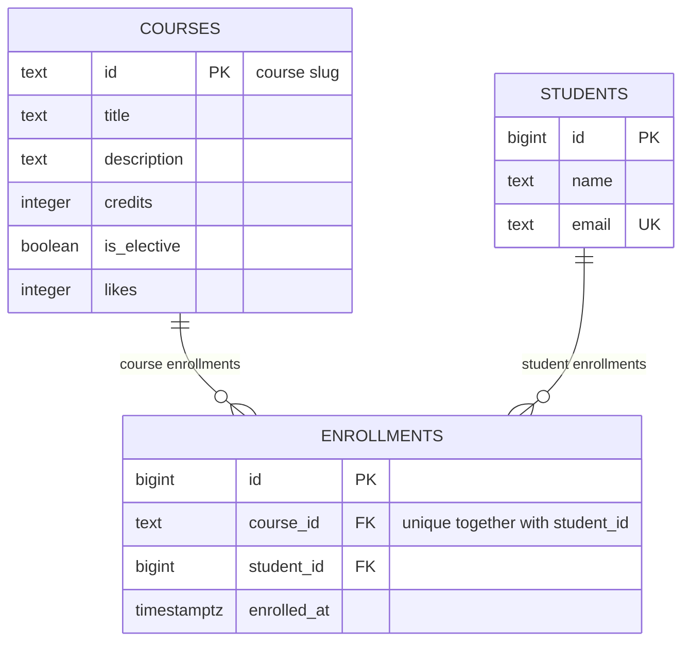

# course-catalog-db

PostgreSQL schema for the course catalog (Lab 6, "Advanced Web Technologies"). The catalog from Labs 4 and 5 (courses, enrollments) moves from the program's memory into three tables: `courses`, `students`, `enrollments`. The FastAPI and Next.js code is not changed in this lab; the database is connected to the backend in week 7.

Files: `schema.sql` (tables, keys, constraints, the index), `seed.sql` (initial data), `queries.sql` (queries for the API routes), `experiments/idx_data.sql` (many rows for the index experiment).

## How to run

PostgreSQL 16 or newer is required. Once, as the `postgres` superuser:

```sql
CREATE ROLE catalog_app LOGIN PASSWORD 'change-me';
CREATE DATABASE course_catalog OWNER catalog_app;
```

Then, from the project folder (it stops at the first error):

```bash
psql -h localhost -U catalog_app -d course_catalog -v ON_ERROR_STOP=1 -f schema.sql
psql -h localhost -U catalog_app -d course_catalog -v ON_ERROR_STOP=1 -f seed.sql
psql -h localhost -U catalog_app -d course_catalog -v ON_ERROR_STOP=1 -f queries.sql
```

The password `change-me` is for teaching; real projects keep passwords out of git. After `schema.sql` and `seed.sql` the tables hold 6 courses, 3 students and 6 enrollments; `queries.sql` can be run any number of times (queries that change data are wrapped in `BEGIN ... ROLLBACK`).

To repeat the index experiment, create a throwaway database (`CREATE DATABASE idx_demo OWNER catalog_app;`), run `schema.sql` and `experiments/idx_data.sql` in it, and drop the index (`DROP INDEX enrollments_student_id_idx;`) to see the plan "before" the index. On Windows, set `$env:PGCLIENTENCODING = "UTF8"` before starting `psql` if you insert non-English text.

## Schema



There are three tables. `courses` and `students` are independent entities, and `enrollments` links them: each of its rows ties one student to one course through two foreign keys. The "many-to-many" relationship (a course has many students, a student takes many courses) lives in `enrollments`, which splits it into two "one-to-many" relationships, and the unique pair `(course_id, student_id)` lets a student enroll in a course only once.

## Design decisions

- **`courses.id` is `text` (a slug), `students.id` is an automatic number.** The slug (`modern-frontend`) is readable, already appears in the API routes and in the frontend URLs, and needs no extra lookup; its downsides are that it is longer than a number and that renaming a slug means updating every row that references it. An automatic `bigint` is short, never changes and does not depend on the data (a student's name and email can change), but it says nothing to a human, is guessable and has gaps. A course has a natural stable identifier, a student does not, so each table got the kind of key that suits it.
- **`RESTRICT` on `enrollments.course_id`, `CASCADE` on `enrollments.student_id`.** Enrollments are the history of what people studied: deleting a course that has enrollments would silently destroy other people's records, so the database refuses (the API answers 409) and someone has to decide consciously what to do with them. An enrollment makes no sense without its student, so when a student is deleted (for example, at their request) the enrollments go with them automatically and no orphans remain.
- **`timestamptz` and not `timestamp`; `text` and not `varchar(n)`.** `timestamptz` stores an absolute moment in time (internally in UTC) and shows it in the time zone of the session, while `timestamp` without a zone is ambiguous as soon as users or servers live in different zones or the clocks change. In PostgreSQL `text` and `varchar(n)` work equally fast, and `varchar(n)` only adds an arbitrary length limit that later breaks real data; if a length rule is needed, it is written explicitly as a `CHECK` (as with the student's name).

## Constraint violation log

Commands were run with `\set VERBOSITY verbose` on PostgreSQL 18.6, from a clean state (`schema.sql` + `seed.sql`).

| # | What we violate | SQLSTATE | Constraint | API response |
|---|-----------------|----------|------------|--------------|
| 1 | NULL in courses.title | 23502 | NOT NULL (it has no name of its own: the message names the column `title`, field `COLUMN NAME`) | 422; if Pydantic let the empty value through, that is a bug in the code (500) |
| 2 | courses.credits = 0 | 23514 | `courses_credits_check` | 422 |
| 3 | courses.likes = -1 | 23514 | `courses_likes_check` | 500: only our code changes the counter (`likes + 1`), so it must never go negative; if it does, there is a bug in the code |
| 4 | a one-letter student name | 23514 | `students_name_check` | 422 |
| 5 | a duplicate student email | 23505 | `students_email_key` | 409 Conflict |
| 6 | a duplicate course id | 23505 | `courses_pkey` | 409 Conflict |
| 7 | a repeated enrollment in a course | 23505 | `enrollments_course_id_student_id_key` | 409 Conflict |
| 8 | enrolling in a nonexistent course | 23503 | `enrollments_course_id_fkey` | 404: course not found |
| 9 | enrolling a nonexistent student | 23503 | `enrollments_student_id_fkey` | 404: student not found (422 would also work; I chose 404 because the id points to a resource that does not exist) |
| 10 | deleting a course that has enrollments | 23001 on PostgreSQL 18 (23503 on PostgreSQL 16 and 17) | `enrollments_course_id_fkey` | 409 Conflict: a course with enrollments can't be deleted |
| 11 | deleting a student (cascade) | no error | `enrollments_student_id_fkey` (`ON DELETE CASCADE`) | not an error: the student's enrollments were deleted by cascade, 6 → 3 enrollments, and 6 again after `ROLLBACK` |

Notes:

- All ten commands ended with an error, and afterwards the tables still held 6 courses, 3 students and 6 enrollments: none of them changed the data.
- The server prints the messages in the language of the system (on my Windows machine they were in Russian); the SQLSTATE codes and the constraint names are the same in any language.
- Errors are told apart by the code class (every constraint violation starts with `23`) and by the constraint name, not by the message text: the text and even the code of experiment 10 depend on the server version.
- The `Failing row contains (4, A, a@example.com)` line of experiment 4 shows that student number 4 was issued before the constraints were checked and is not returned to the counter after the error. A `GENERATED ALWAYS AS IDENTITY` column guarantees unique numbers, not the absence of gaps.
- Extra check: `INSERT INTO students (id, ...) VALUES (100, ...)` fails with SQLSTATE `428C9` ("cannot insert a non-DEFAULT value into column id", the column is `GENERATED ALWAYS`). This is not a user error but a bug in the code: the API would answer 500.

**Why check the name length in the database if Pydantic already checks it (`Field(min_length=2)`)?** The API is not the only thing that writes to the database: there are also other services, import scripts, migrations, manual fixes in `psql` and future versions of the API with their own bugs. A check in the code protects only the data that goes through that code, while a constraint in the database protects the data no matter who writes it and cannot be bypassed. Pydantic still stays useful: it rejects a bad request earlier and gives the client a clear 422 message, without a round trip to the database. So the rule is checked twice on purpose: the code is for a friendly answer, the database is for the guarantee.

## Index: EXPLAIN before and after

Query: `SELECT * FROM enrollments WHERE student_id = 777;`

Database `idx_demo` (the same schema, without the index at first): 500 courses, 20,000 students, 50,000 enrollments (`experiments/idx_data.sql`). PostgreSQL 18.6; the times depend on the computer, the plans do not.

| | Before the index | After the index |
|---|------------------|-----------------|
| Access method | `Seq Scan` on enrollments | `Bitmap Index Scan` on `enrollments_student_id_idx` + `Bitmap Heap Scan` |
| cost | 0.00..1042.00 | 4.31..15.59 |
| Rows Removed by Filter | 49997 | no filter: the 3 rows are found through the index |
| Execution Time (best of three runs) | 4.290 ms (5.846 / 4.290 / 4.302) | 0.073 ms (0.145 / 0.073 / 0.077) |

About 60 times faster. The first run is always the slowest (the data is not in the cache yet), which is why the best of three is taken. The index takes 896 kB next to the 3336 kB table (about a quarter of its size) and slows inserts, updates and deletes a little, because every change has to be reflected in the index too.

Before (`EXPLAIN ANALYZE`, the best of three runs):

```text
 Seq Scan on enrollments  (cost=0.00..1042.00 rows=3 width=34) (actual time=0.134..4.260 rows=3.00 loops=1)
   Filter: (student_id = 777)
   Rows Removed by Filter: 49997
   Buffers: shared hit=417
 Planning Time: 0.126 ms
 Execution Time: 4.290 ms
```

After (`CREATE INDEX enrollments_student_id_idx ON enrollments (student_id);`, `EXPLAIN ANALYZE`, the best of three runs):

```text
 Bitmap Heap Scan on enrollments  (cost=4.31..15.59 rows=3 width=34) (actual time=0.042..0.046 rows=3.00 loops=1)
   Recheck Cond: (student_id = 777)
   Heap Blocks: exact=3
   Buffers: shared hit=5
   ->  Bitmap Index Scan on enrollments_student_id_idx  (cost=0.00..4.31 rows=3 width=0) (actual time=0.023..0.024 rows=3.00 loops=1)
         Index Cond: (student_id = 777)
         Index Searches: 1
         Buffers: shared hit=2
 Planning Time: 0.138 ms
 Execution Time: 0.073 ms
```

The `Buffers` and `Index Searches` lines are extra output of newer PostgreSQL versions (18); the plan itself is the same. `Buffers: shared hit=417` means 417 pages were read to scan the table; the index needs 5.

The other two plans from the experiment (before the index):

| Query | Plan | Where the index comes from |
|---|---|---|
| `students WHERE email = 'student777@example.com'` | `Index Scan using students_email_key` | the `UNIQUE` constraint creates an index by itself |
| `enrollments WHERE course_id = 'course-7'` | `Bitmap Index Scan on enrollments_course_id_student_id_key` | the index on the unique pair `(course_id, student_id)` also works for a search on the first column of the pair |

In the main database, a primary-key lookup on the six-row `courses` table still uses `Seq Scan` (cost 1.07): the whole table fits in one data page, so reading it is cheaper than going through the index.

Answers to the questions:

1. PostgreSQL creates an index by itself only for `PRIMARY KEY` and `UNIQUE`, because it needs one to check uniqueness quickly. `email` is `UNIQUE`, and `course_id` is the first column of the unique pair `(course_id, student_id)`, so both are covered. A `FOREIGN KEY` creates no index: the database cannot know which queries you are going to run. `student_id` is only the *second* column of the pair, and a B-tree sorted by `(course_id, student_id)` does not help to find a value of the second column alone, so the search had to read the whole table.
2. For six rows the whole table fits in one data page, and reading it sequentially (cost 1.07) is cheaper than first going through the index and then to the table. The planner compares costs, and "there is an index" does not mean "the index will be used". For 50,000 rows the sequential read costs 1042 and the index about 15, so the index wins clearly.
3. (a) The query "one student's enrollments" (`WHERE student_id = ...`), also a `JOIN` that starts from a student. (b) The cascading delete of a student: to delete the student's enrollments, the database has to find all rows with that `student_id`, and without the index it would read the whole `enrollments` table for every deleted student.

## Transaction

Scenario: enroll a new student in a course — two inserts in one transaction (`INSERT INTO students ...`, then `INSERT INTO enrollments ...`).

**The second insert fails** (enrollment in the nonexistent course `no-such-course`):

```text
BEGIN
INSERT 0 1
ERROR:  insert or update on table "enrollments" violates foreign key constraint "enrollments_course_id_fkey"
DETAIL:  Key (course_id)=(no-such-course) is not present in table "courses".
ERROR:  current transaction is aborted, commands ignored until end of transaction block
ROLLBACK
 count
-------
     0
```

- The second insert failed with a foreign-key violation. The transaction was **aborted**: in an interactive psql the prompt turns into `=!>`, and every following command, even a harmless `SELECT count(*) FROM students`, is rejected with `current transaction is aborted, commands ignored until end of transaction block`. You get out of this state only with `ROLLBACK`.
- After `ROLLBACK`, Madina is not in the database (`count = 0`): the first insert was rolled back as well, although it was correct on its own. No student without an enrollment appeared.

**The successful variant, two windows** (two separate `psql` sessions, A and B):

```text
-- window A                                   -- window B
BEGIN;
INSERT INTO students ...      -> INSERT 0 1
INSERT INTO enrollments ...   -> INSERT 0 1
(not committed yet)
                                              SELECT count(*) ... madina@example.com;  -> 0
COMMIT;
                                              SELECT count(*) ... madina@example.com;  -> 1
```

- Window B saw **0** (no Madina) before `COMMIT` and **1** after `COMMIT`: both rows appeared at once. Uncommitted changes are invisible to other clients; this isolation level is called `read committed` (`SHOW default_transaction_isolation` returned `read committed`, the default).
- After the commit, the join in window A returned `Madina Ospanova | Web Security Essentials`, and the tables held 4 students and 7 enrollments (so the data differs from `seed.sql`; run `schema.sql` and `seed.sql` again for a clean state).
- Without a transaction, each command would be committed by itself (autocommit). The first insert would stay in the database, the second one would fail, and we would end up with a student who has no enrollment: "half an operation", inconsistent data that someone would have to find and clean up by hand.

In week 7, one API request will be one short transaction: the SQLAlchemy session opens it, and the route handler ends it with `commit()` or rolls it back on an exception. Transactions are kept short because the rows changed by an open transaction cannot be changed by anyone else.

## Self-review against the checklist

| What to check | Result |
|---------------|--------|
| Keys | Yes. Every table has a primary key (`courses.id` text, `students.id` and `enrollments.id` bigint identity), and each of the two relationships has a foreign key (`enrollments.course_id`, `enrollments.student_id`). |
| Types | Yes. Identifiers of students and enrollments are `bigint`, the course slug is `text`, `credits` and `likes` are `integer`, the flag is `boolean`, the moment of enrollment is `timestamptz`. There is no money in this schema, so `numeric` is not needed. |
| Required values | Yes. Every column is `NOT NULL`: each value is required by the domain, so NULL is not allowed anywhere. Defaults are set for `is_elective` (false), `likes` (0) and `enrolled_at` (now()); the ids are issued by the database. |
| Constraints | Yes, with one gap. `CHECK`: `credits > 0`, `likes >= 0`, a student's name of at least two characters (the same rule as `Field(min_length=2)` in Pydantic); `UNIQUE`: email and the pair `(course_id, student_id)`. The gap: the format of the email is not checked in the database, only its uniqueness. |
| Deletion | Yes. `RESTRICT` for a course with enrollments and `CASCADE` for a student's enrollments, chosen deliberately (see Design decisions) and proved by the violation log (#10, #11). |
| Normalization | Yes. Every fact is stored once: the student's name and email only in `students`, the course's title and credits only in `courses`; `enrollments` holds only references. There are no lists of values in a single cell. |
| Indexes and names | Yes. The foreign key `student_id` has an index (`enrollments_student_id_idx`, justified by `EXPLAIN`), `course_id` is covered by the index of the unique pair, and no unneeded indexes were added (the six-row `courses` table would not use one). Names are consistent: snake_case, plural table names, `course_id`, `<table>_<column>_idx`. |
